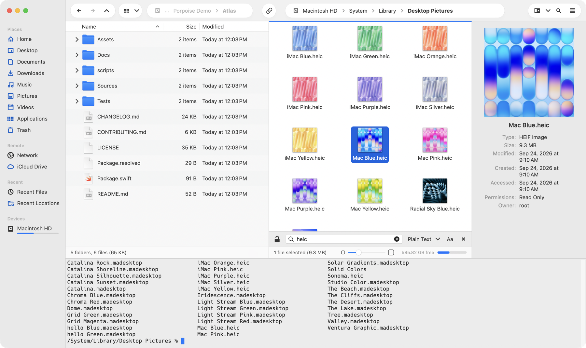
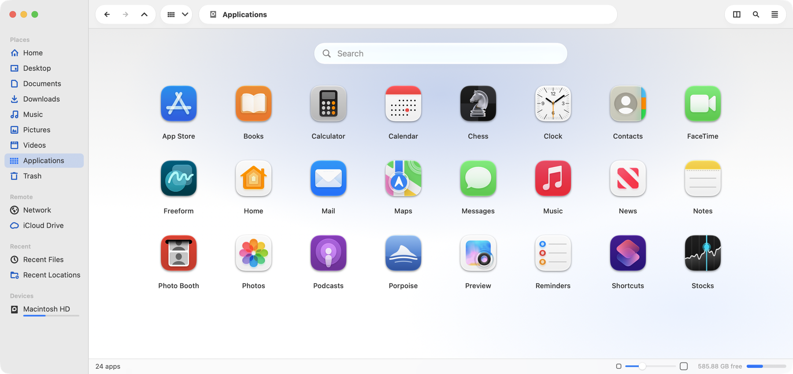

# Porpoise

[](https://github.com/El3ssar/porpoise/actions/workflows/ci.yml)

**A fast, keyboard-friendly file manager for macOS, inspired by KDE Dolphin.**

Split view, a built-in terminal that follows the folder you're in, tabs, panels, Finder tags, remote folders over
SSH/FTP, Google Drive (preview), Dropbox, S3-compatible storage, and video previews, in a native Mac app
with light and dark appearances, built-in colour themes and a choice of icon themes.

<picture>
  <source media="(prefers-color-scheme: dark)" srcset="docs/screenshots/panes-dark.png">
  
</picture>

<picture>
  <source media="(prefers-color-scheme: dark)" srcset="docs/screenshots/applications-dark.png">
  
</picture>

> Porpoise is an independent, open-source project. It follows KDE Dolphin's layout and behaviour (thank you, KDE!),
> but it is not affiliated with KDE.

## Install

1. Download [**Porpoise.dmg**](https://github.com/El3ssar/porpoise/releases/latest/download/Porpoise.dmg) (or pick a version on the [releases page](https://github.com/El3ssar/porpoise/releases)).
2. Open it and drag **Porpoise** onto **Applications**.
3. Open Porpoise. Because Porpoise isn't signed through Apple's paid developer program, macOS blocks it the first
   time: open **System Settings › Privacy & Security**, scroll to *"Porpoise was blocked…"* and click **Open Anyway**
   ([each step, with pictures](https://porpoise.dev/install/)).
   You only do this once. (Terminal alternative: `xattr -dr com.apple.quarantine /Applications/Porpoise.app`.)
4. Porpoise opens straight to your home folder, with a short welcome that offers **Full Disk Access** (every folder,
   including the Trash). Anything else is asked for the first time it's needed: **App Management** when you first move
   or delete an app, **Administrator Actions** (a small "Porpoise Helper", installed with one password) the first time
   you change a system-owned item such as an App Store app in the Trash, and **Local Network** when you first open Network.
   All of them are listed in *Porpoise › Permissions…* (Settings › System).

Requirements: a Mac with Apple Silicon and **macOS 15 Sequoia or newer**. Everything Porpoise needs is inside the
app; nothing else to install. (Android phones need Google's adb tool, which Porpoise downloads for you from
*Settings › System* if you want it.)

Updates: Porpoise checks once a day and updates itself in place: one click, it installs and relaunches, and your
permissions stay. Turn the daily check (or fully automatic updates) on or off in Settings › General, or check any time
with *Porpoise › Check for Updates…*.

## Features

- **Window:** toolbar with Back/Forward/Up, breadcrumb or editable location bar, tabs, split view (F3) with one
  location bar per pane, full-width status bar with free space and a zoom slider.
- **Views:** Icons, Compact, Details (expandable folders, sortable/resizable/reorderable columns) and Columns
  (Finder's column view with a preview column, on local, remote and cloud folders), smooth zoom
  (pinch, slider, ⌘+/−), previews of images, documents and every video format, grouping, natural sorting,
  type-ahead, inline rename, rubber-band and selection mode, filter bar.
- **Search:** fast search of names and contents with the bundled fd and ripgrep (results stream in, content matches
  show the line they were found in), or everywhere with Spotlight. Items glide into place as results come and go.
  Turn on the file index (Settings › Search) for Everything-style instant search: a million names in a few
  milliseconds as you type, with `ext:`, `size:`, `dm:`, `path:`, `folder:`, `regex:`, kept current by FSEvents, and an
  optional content index for text files.
- **Looks:** ten themes (Breeze Light/Dark, Nord, Dracula, Solarized Light/Dark, Gruvbox, Catppuccin, Tokyo Night,
  High Contrast), system light/dark pairing, live colour editor, and import/export. Choose native or freedesktop icons,
  folder colours, fonts and density in Settings › Appearance; icons glide when the window or a pane is resized.
- **Applications:** an app library instead of a plain folder: every app (including Apple's own) as big icons, a
  search field you can type into right away, with the results animating into place. Delete apps with ⌘⌫ or by
  dragging them to the Trash in the Dock, with Finder's sounds; drop an app from a disk image to install it.
- **Panels:** Places (foldable, reorderable sections; devices with capacity bars and eject; tags; network), Folders
  tree, Information (big preview, metadata, inline video/audio player) and a **Terminal** (F4) running your own
  shell that follows the view, and the view follows it. The **Shelf** (F8) holds references to files from different
  folders so you can collect them before copying, moving or sharing them.
- **File utilities:** SHA-256/512 checksums, legacy MD5/SHA-1, GNU/BSD manifest verification and export; a drill-down disk-usage map and duplicate review with APFS clone-family reporting and undoable Trash.
- **Activity:** **⌥⌘J** opens one place for local and remote jobs, progress, pause/cancel, retry, verification and
  operation history. Supported interrupted transfers can be resumed after relaunch; recovery rechecks the source
  and destination before continuing.
- **Compare Files:** compare two text or image files and their metadata with **⌥⌘Y**; image comparison includes
  an overlay for spotting changes.
- **Files:** previewed batch rename (F2) with ordered rules, regex captures, numbering, dates/media tokens, presets and
  one-step undo; copy/move/link/trash with progress and undo, Dolphin's drop menu, conflict dialog, Create New,

  Duplicate, Compress/Extract, Properties (permissions, Open with + Change All, tags, comments, locked), Restore
  from Trash, admin authentication for protected items.
- **Finder parity:** Quick Look (Space), tags with colours, aliases, Get Info, Go to Folder and Finder's keyboard
  shortcuts, Services, AirDrop/Share, iCloud and cloud-drive status with Download Now / Remove Download, Smart
  Folders, Eject, drag & drop with any app and the Dock Trash; optionally the default file browser for
  "Show in Finder".
- **Remote:** SFTP/SSH, FTP/FTPS, SMB/AFP/NFS/WebDAV (Connect to Server ⌘K), Bonjour network browsing, Android
  phones over USB, local zip/7z/tar archives browsed without unpacking (read-only, with extraction on open, preview or copy). Other formats retain whole-archive fallback. **Connections** (⌥⌘K) saves SFTP, FTP/FTPS, SMB and S3 servers,
  with imported SSH hosts, jump hosts and key-file settings. Passwords and S3 secret keys stay in the Keychain.
- **Cloud accounts:** browse **Google Drive (preview)** and **Dropbox**, copy files in and out, preview and open
  them, keep offline copies, and save edits back with conflict review. Drive sign-in currently requires an invited
  account while Google's verification is pending; Dropbox's development app has a linked-account limit.
  **S3-compatible storage** supports bucket/prefix browsing and resumable multipart uploads. OneDrive and Box are
  implemented but unavailable in public builds until their app registrations are configured.
- **Accessibility:** VoiceOver reads and drives the file view, Places, tabs, the path bar and the app library; toolbar
  buttons are reachable with Tab under Full Keyboard Access; Reduce Motion and Increase Contrast are respected.

## Checksums, disk usage and duplicates

Select files/folders, then choose **Tools › Checksums…**, **Disk Usage…**, or **Find Duplicates…**. With no selection,
the current folder is used. Each utility runs in the background and has Cancel.

Checksums supports SHA-256 and SHA-512, plus MD5 and SHA-1 clearly labelled as legacy. Compare a pasted value,
verify GNU/BSD `.sha256`, `.sha512`, `.md5` or SHASUMS manifests, and export a manifest beneath a common folder.
Manifest paths stay inside the manifest's folder; symlinks escaping it are rejected.

The disk map switches between logical and allocated bytes, with sortable columns, directory drill-down, Reveal and
undoable Trash. Hard links count once; APFS clones can share allocated space, so the map does not promise exact
reclaimable bytes. Enable **Settings › View › Folder size › Show size of contents** to use the same scanner and cache
in the Details Size column, with your chosen depth limit. Scans include hidden files, skip symlink targets and stay
on selected volumes.

Duplicate Finder first groups sizes, then checks the first/last 64 KiB and full SHA-256. Empty files, symlink targets
and aliases to the same inode are ignored. APFS clone families are identified when supported. Nothing is selected
for removal automatically: apply a keep rule (newest, oldest, shortest path, or preferred folder), review the marked
copies, then move them to Trash. At least one copy must remain; files and keepers are revalidated before the move.
Use **Edit › Undo** to restore them.

## Application cleanup and templates

Move to Trash treats an app as Finder does: it goes straight to the Trash and its support files stay. To clean up
after it, choose **Remove App and Leftovers…** (Tools or context menu; Settings › Confirmations can ask on every app
deletion) and review related Library files, with sizes and matching reasons. Related files start unchecked;
shared app groups, ambiguous names and files claimed by other installed apps are kept. The selected app and reviewed
files move to Trash with Undo; this cleanup never offers permanent deletion.

Choose **Create New › From Template…** for an editable template and a resolved filename/content preview. Use
`{date}`, `{time}`, `{user}`, `{name}`, `{counter}` or padded counters such as `{counter:03}`. Counters choose an unused
filename; existing files are never overwritten. Save/edit personal templates, import ordinary files or template
archives, export portable archives, and open the template folder in Application Support.

## Appearance and terminals

Settings › Appearance has theme preview cards, grouped controls and compact colour grids; changes preview in open windows. Import KDE `.colors` files or Porpoise theme JSON,
edit the semantic colours and 16 ANSI colours, then export a theme. **Export Appearance** also includes fonts, density,
icon choices, shell and terminal settings; **Import Appearance** validates the complete file before applying it.

Choose Tela-circle, Papirus, Breeze, Fluent, WhiteSur, Colloid or native macOS icons. Folder colours preserve shading,
including special folders and sidebar icons; choose a preset or use the Folder tint colour well.

Install freedesktop icon themes as `~/Library/Application Support/Porpoise/icons/<theme>/index.theme` with the theme's
icon directories alongside it, then reopen Settings. SVG, PNG and PDF icons and installed parent themes are supported;
missing icons fall back to bundled Tela-circle. Native macOS uses NSWorkspace file icons.

The F4 panel supports the login shell, zsh, bash, fish, nu, or a custom executable with arguments entered as a JSON
array (for example `["-l"]`). Shell changes apply to new sessions; colours, font, cursor and scrollback update live.
Import terminal schemes from Konsole `.colorscheme` or iTerm2 `.itermcolors` files.

For Open Terminal Here and Run script, choose Terminal, iTerm2, kitty, WezTerm, Ghostty, Alacritty, Warp or a custom
command. Settings marks unavailable apps. Automatic preserves the preference for kitty, then other installed terminals.
A custom command must contain bare `{dir}` outside quotes, for example `kitty --directory {dir}`; Porpoise quotes the
path. Run script appends the quoted script path. Custom icon themes and shell/terminal applications need to be installed
on each Mac; exporting preferences does not bundle them. [Format and integration details](docs/design/THEMING.md).

## Batch rename

Select multiple local files or folders and press **F2** (or File › Rename). Add rules in execution order and review
Current name / New name / Status before applying. Find/replace supports regular expressions with `$1`, `$2` capture
references. Numbering lets you choose start, step, padding and character position. Insert/remove positions count visible
characters from zero; −1 inserts at the end. Keep, lowercase or replace extensions independently of the name rules.

Name templates and inserted text accept `{name}`, `{ext}`, `{created:yyyy-MM-dd}`, `{modified:yyyy-MM-dd}`,
`{exif:yyyy-MM-dd}`, `{width}`, `{height}`, `{artist}`, `{album}` and `{title}`. Image dates/dimensions come from file
headers; available audio tags come from Spotlight. Missing metadata blocks the affected row. Presets save the whole
pipeline and extension mode. The preview blocks collisions with other selected or unselected items, including
Unicode-equivalent names and case-insensitive matches on the destination volume.

The batch uses temporary names for swaps and cycles, rechecks source identity and destination names before execution,
and never overwrites existing items. **Undo: Batch Rename** restores the entire operation in one step. These transaction
guarantees apply to local files; remote items retain individual rename. [Implementation and recovery](docs/design/BATCH_RENAME.md).

## Command palette and custom controls

**⌘⇧P** or **⌃⌥I** opens the command palette. Search menu actions by partial words, initials or a fuzzy sequence;
results also include Places/bookmarks, recent locations, open tabs in every window, and connections saved in Places or
visited in open tabs. Arrow keys choose a result, Return runs it, and Escape closes the palette. Unavailable commands
stay visible with an explanation. Commands use the originating window's selection and normal confirmation dialogs.

In **Settings › Shortcuts**, filter actions, select one, then **Record Shortcut**. Clear removes its default aliases too;
Reset Selected and Reset All restore defaults. Conflicts with other actions are blocked, including hidden alternate
bindings. JSON import validates the whole file before applying it; export contains overrides, allowing future defaults
to remain available. Menu keys update immediately and persist across launches. Text editing and basic view-navigation
keys remain local to their controls; macOS-reserved shortcuts still belong to the system.

**View › Customize Toolbar** opens a native macOS toolbar editor. Drag actions in its palette to add, remove or reorder
them; main windows preview the layout live. The Location field stays available and continues to align with split panes.
Optional actions include Reload, New Tab, Terminal and Command Palette. Narrow windows move excess actions into the
main-menu path. Restore defaults from the editor or Settings › Shortcuts. [Formats and verification](docs/design/COMMANDS.md).

## Keyboard shortcuts

Finder's shortcuts, plus Dolphin's panels and split view. Prefer Dolphin's own keys (⌘H hidden files, ⌘I filter, F2
rename, Return opens, ⌦ trash)? Settings › Shortcuts › Key set › Dolphin switches in one click. Any menu command can be
given its own shortcut there, and **Help › Keyboard Shortcuts (⌘?)** lists everything in effect.

In the file list: arrows move (⇧ extends), Space is Quick Look, ⌫ goes back, `/` filters, ⌥. shows hidden files,
⌃Space adds or removes the current item, and typing a name selects it. The menu bar with the default keys:

<details><summary>All menu shortcuts</summary>

<!-- shortcuts:begin -->
| Menu | Action | Keys |
|---|---|---|
| Porpoise | Settings… | ⌘, |
| Porpoise | Hide Porpoise | ⌘H |
| Porpoise | Hide Others | ⌥⌘H |
| Porpoise | Quit Porpoise | ⌘Q |
| File | Create New › Folder… | ⇧⌘N |
| File | Open | ⌘O or ⌘↓ |
| File | New Window | ⌘N |
| File | New Tab | ⌘T |
| File | Close Tab | ⌘W |
| File | Undo Close Tab | ⇧⌘T |
| File | Close Window | ⇧⌘W |
| File | Rename… | ↩ or F2 |
| File | Duplicate Here | ⌘D |
| File | Move to Trash | ⌘⌫ |
| File | Delete Immediately… | ⌥⌘⌫ |
| File | Make Alias | ⌃⌘A |
| File | Show Original | ⌘R |
| File | New Folder with Selection | ⌃⌘N |
| File | Eject | ⌘E |
| File | Save Changes | ⌘S |
| File | Compare Files… | ⌥⌘Y |
| File | Quick Look | ⌘Y |
| File | Get Info | ⌘I |
| Edit | Undo | ⌘Z |
| Edit | Redo | ⇧⌘Z |
| Edit | Command Palette… | ⇧⌘P or ⌃⌥I |
| Edit | Cut | ⌘X |
| Edit | Copy | ⌘C |
| Edit | Copy Location | ⌥⌘C |
| Edit | Add to Shelf | ⌥⌘S |
| Edit | Paste | ⌘V |
| Edit | Filter… | ⌥⌘F |
| Edit | Search… | ⌘F |
| Edit | Select Files and Folders | ⇧⌘Space |
| Edit | Copy to Other View | ⇧F5 |
| Edit | Move to Other View | ⇧F6 |
| Edit | Select All | ⌘A |
| Edit | Deselect All | ⌥⌘A |
| Edit | Invert Selection | ⌥⇧⌘A |
| Edit | Select Matching… | ⇧⌘S |
| Edit | Deselect Matching… | ⌥⇧⌘S |
| View | Zoom In | ⌘+ or ⌘= |
| View | Reset Zoom Level | ⌘0 |
| View | Zoom Out | ⌘- |
| View | View Mode › Icons | ⌘1 |
| View | View Mode › Details | ⌘2 |
| View | View Mode › Compact | ⌘3 |
| View | View Mode › Columns | ⌘4 |
| View | Show Previews | F12 |
| View | Show Hidden Files | ⇧⌘. |
| View | Adjust View Display Style… | ⌘J |
| View | Linked Browsing | ⌃⌘L |
| View | Split | F3 |
| View | Split View to Tabs | ⇧⌘F3 |
| View | Pop out Split View | ⇧F3 |
| View | Focus Other View | ⌘F3 |
| View | Focus Left View | ⌥← |
| View | Focus Right View | ⌥→ |
| View | Reload | F5 |
| View | Show Panels › Places | F9 |
| View | Show Panels › Information | F10 or ⌥⌘I |
| View | Show Panels › Folders | F7 |
| View | Show Panels › Terminal | F4 |
| View | Show Panels › Shelf | F8 |
| View | Show Panels › Focus Places Panel | ⌘P |
| View | Show Panels › Focus Terminal Panel | ⇧⌘F4 |
| View | Location Bar › Editable Location | F6 |
| View | Location Bar › Replace Location | ⌘L |
| View | Enter Full Screen | ⌃⌘F |
| Go | Up | ⌥↑ or ⌘↑ |
| Go | Back | ⌘[ or ⌘← |
| Go | Forward | ⌘] or ⌘→ |
| Go | Home | ⌥Home or ⇧⌘H |
| Go | Recents | ⇧⌘F |
| Go | Documents | ⇧⌘O |
| Go | Desktop | ⇧⌘D |
| Go | Downloads | ⌥⌘L |
| Go | Computer | ⇧⌘C |
| Go | Applications | ⇧⌘A |
| Go | Utilities | ⇧⌘U |
| Go | iCloud Drive | ⇧⌘I |
| Go | Library | ⇧⌘L |
| Go | AirDrop | ⇧⌘R |
| Go | Network | ⇧⌘K |
| Go | Go to Folder… | ⇧⌘G |
| Go | Connect to Server… | ⌘K |
| Go | Connections… | ⌥⌘K |
| Tools | Open Terminal | ⇧F4 |
| Tools | Open Terminal Here | ⌥⇧F4 |
| Tools | Reveal in Finder | ⌥⌘R |
| Tools | Empty Trash | ⇧⌘⌫ |
| Window | Minimize | ⌘M |
| Window | Activity | ⌥⌘J |
| Window | Next Tab | ⌃⇥ or ⌘} or ⌘Page Down |
| Window | Previous Tab | ⌃⇧⇥ or ⌘{ or ⌘Page Up |
| Window | Go to Tab › Tab 1 | ⌥1 |
| Window | Go to Tab › Tab 2 | ⌥2 |
| Window | Go to Tab › Tab 3 | ⌥3 |
| Window | Go to Tab › Tab 4 | ⌥4 |
| Window | Go to Tab › Tab 5 | ⌥5 |
| Window | Go to Tab › Tab 6 | ⌥6 |
| Window | Go to Tab › Tab 7 | ⌥7 |
| Window | Go to Tab › Tab 8 | ⌥8 |
| Window | Go to Tab › Tab 9 | ⌥9 |
| Window | Go to Tab › Last Tab | ⌥0 |
| Window | Save Workspace… | ⌃⌘S |
| Help | Keyboard Shortcuts | ⌘? |
<!-- shortcuts:end -->

</details>

## Reliability and security

- Code changes are checked by CI with real throwaway files and disk images, a private SSH server, generated
  videos and fake cloud servers. CI enforces at least **92% combined line coverage** of the logic layers, strict
  format lint, helper freshness and a separate shipping build. This coverage does not measure rendered UI quality.
- The [successful main CI run on 2026-10-18](https://github.com/El3ssar/porpoise/actions/runs/39173254225)
  ran **1,497 tests in the main pass and 9 in a resource-isolated pass**, with **93.7%** combined logic coverage.
  The main pass reported one expected issue from the timeout regression test. These are dated results, not a
  guarantee about later commits.
- The administrator helper does only single file operations, accepts only Porpoise signed with its own certificate
  and intact on disk, and never changes ownership outside your Trash. [SECURITY.md](SECURITY.md) describes how each
  part is protected and how to report a vulnerability privately.
- Remote file names are treated as untrusted: they're quoted and checked before they reach a shell, an FTP command or
  the disk.


Porpoise is free and always will be. If it's useful to you, you can support its development through
[GitHub Sponsors](https://github.com/sponsors/El3ssar) (also in *Help › Support Porpoise*). Bug reports and ideas are
just as welcome: *Help › Report a Bug…* opens the bug form with your Porpoise and macOS versions filled in, after
an optional export of diagnostics to attach (shown before saving; no file names, paths, servers or accounts), or [open an issue](https://github.com/El3ssar/porpoise/issues).

## Build from source

You need macOS 15+ on Apple Silicon and Xcode 26 (or its Command Line Tools).

```bash
./scripts/make-app.sh             # builds build/Porpoise.app (the first run also builds the bundled FFmpeg)
./scripts/make-app.sh --install   # …and copies it to ~/Applications
./scripts/make-dmg.sh             # release disk image in build/
./scripts/test-with-watchdog.sh    # full test suite with bounded runtime and hang diagnostics
```

See [CONTRIBUTING.md](CONTRIBUTING.md) for the project layout, the test bridge used to check the running app,
and how releases are made.


To reproduce archive listing's fixed 100,000-entry, 4 GB ZIP budget without allocating a 4 GB payload on disk:

```sh
python3 scripts/archive-benchmark-fixture.py /tmp/porpoise-100k-4gb.zip
swift run -c release -j 2 ArchiveBenchmark /tmp/porpoise-100k-4gb.zip
```

The fixture contains a valid stored zero-filled payload in a sparse file. The probe includes the first listing
and entry URL construction, checks that no files appeared in its isolated cache, and fails at two seconds.

## Licence and credits

Porpoise is free software under the **GNU General Public License v3.0 or later** ([LICENSE](LICENSE)).

- Layout and behaviour follow [KDE Dolphin](https://apps.kde.org/dolphin/).
- Icons: [Tela circle](https://github.com/vinceliuice/Tela-circle-icon-theme) by Vince Liuice (GPL-3.0).
- Colours: Desert theme by L4ki (AGPL-3.0).
- Terminal: [SwiftTerm](https://github.com/migueldeicaza/SwiftTerm) by Miguel de Icaza (MIT).
- Video previews: [FFmpeg](https://ffmpeg.org) (LGPL-2.1), bundled as a separate program.
- Search: [fd](https://github.com/sharkdp/fd) (MIT/Apache-2.0) and [ripgrep](https://github.com/BurntSushi/ripgrep)
  (MIT/Unlicense), bundled inside the app (they aren't added to your `PATH`).
- Symbols Nerd Font (MIT).

Details in [THIRD_PARTY_NOTICES.md](THIRD_PARTY_NOTICES.md).
