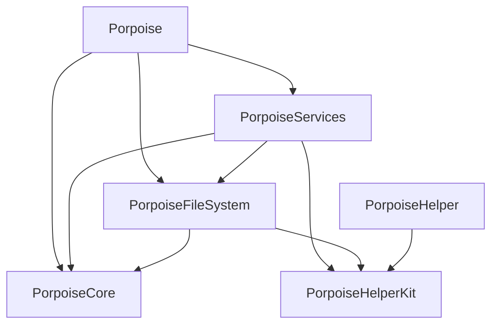

# Architecture

Porpoise separates shared contracts, local filesystem IO, helper security and app orchestration into four logic targets.

## Layers

**PorpoiseCore** (`Sources/PorpoiseCore`). Shared value models, parsers, formatting, index/query algorithms,
conflict policy and synchronization contracts. It performs no filesystem IO, process execution or code-signing
checks. `FileItem` is a value; `FilePath` stores a resolved identity and provides lexical containment. Both
Core and HelperKit are leaves with no project-target dependencies.

**PorpoiseFileSystem** (`Sources/PorpoiseFileSystem`). Local metadata/listing, path resolution, physical traversal,
`FileJob` (copy/move/trash/delete with conflicts), Undo, verification, FSEvents and filesystem containment checks.
It depends on Core and uses HelperKit's strict existing-path resolver. It has no Services, AppKit or SwiftUI dependency.

**PorpoiseHelperKit** (`Sources/PorpoiseHelperKit`). The helper's XPC protocol, caller/request validation, code-signing
checks and strict libc `realpath` primitive. The privileged executable links only this target. Its Objective-C
protocol name is preserved across the module move for installed helper compatibility.

**PorpoiseServices** (`Sources/PorpoiseServices`). The app's behaviour without its looks. It may use Foundation,
AVFoundation, Network, NetFS, Security, ServiceManagement, CryptoKit, UniformTypeIdentifiers, AudioToolbox and SQLite3,
never AppKit or SwiftUI.

| Folder | What |
|---|---|
| `Settings` | `Settings` and `@Pref` (UserDefaults; `Settings.store` is replaceable), settings enums, `PanelSize`, migration |
| `FileOperations` | `FileOperationsController`: jobs, undo/redo, Trash origins and Put Back, clipboard bookkeeping, remote transfers, the administrator retry; `FileOperationsUI` and `FileClipboard` |
| `Locations` | `DirectoryModel` (what a view shows), `PlacesModel`, recent locations, search (bundled fd/ripgrep in folders, Spotlight everywhere) and queries, tags, comments, cloud state, archives, the app library, Trash info, icon names (`IconTheme`), path completion |
| `Remote` | `RemoteFS` and the SSH/FTP/ADB providers, Keychain, Android tools, network mounts and browsing, `RemoteOpener` |
| `Cloud` | `CloudAccounts` (connected cloud accounts as the app shows them: labels, sidebar rows, pictures, sections) over a `CloudBackend`: `DriveCloudBackend` for Google Drive, `DemoCloudBackend` for tests and test instances (`PORPOISE_CLOUD_DEMO`) |
| `Drive` | Google Drive: OAuth (PKCE, loopback), the Drive v3 client, `DriveAccountStore` and the read-only `DriveProvider` |
| `Media` | `VideoPreview` (ffmpeg to HLS) and its local HTTP server |
| `System` | `Shell`, `PrivilegedHelper` (install, XPC, ownership), `PrivacyAccess` (TCC), Local Network access, `StatusCenter`, Finder sounds |

**Porpoise** (`Sources/Porpoise`). AppKit only where it draws or asks: `App` (delegate, `ServicesSetup`, system
integration, updates, test bridge), `Window`, `Views`, `Panels`, `Bars`, `Navigator`, `Menus`, `Dialogs`, `Theme`,
and `FileOperations` (the drop menu, jobs panel, conflict dialog and `FileOperationsDialogs`).

**PorpoiseHelper** (`Sources/PorpoiseHelper`). The launchd daemon, run as root. It only accepts Porpoise's signature
and hands every request to `HelperRequests` in PorpoiseHelperKit. Its binary is committed in `Resources/Helper`; see
CONTRIBUTING.md before changing anything it uses.

## Rules

- Dependencies point down only as shown above. The helper depends on HelperKit alone.
- No AppKit or SwiftUI in any logic target. When a service needs the user (a question, a login, opening a file), it goes through
  a small hook the app fills in `App/ServicesSetup.swift`: `FileOperationsController.ui` and `.clipboard`,
  `RemoteFS.askLogin`, `RemoteOpener.openFile`. Volume notifications are forwarded to `PlacesModel.refreshDevices()`.
- Services post `Notification`s (`Settings.changed`, `FileOperationsController.foldersChanged`, `PlacesModel.changed`,
  `StatusCenter.message`…); views observe them. Services never hold views.
- `public` only for what the app uses. Settings keys, file formats (places.json, trash origins), bundle and helper
  identifiers and DebugBridge commands are part of users' data and the tests: don't change them.
- Core, FileSystem, HelperKit and Services are where tests go: anything that can be decided without a window belongs there.
- `Settings.isTesting` (set from `PORPOISE_DEFAULTS_SUITE`) keeps test runs away from the system: no helper, no sounds,
  no places.json, a private pasteboard.

## A file operation, end to end

File › Move to Trash (⌘⌫):

1. **Menu → action.** The menu item targets the first responder; `MainWindowController.moveToTrash(_:)`
   (`Window/MainWindowActions.swift`) calls `FileOperationsController.shared.trash(selectedURLs, window: window)`.
2. **Service.** `trash` sorts remote items (deleted after a `Confirmation`), apps on the system volume (a notice) and
   local items, asks if Settings say so, then `run(.trash, …)`. Every question goes to `ui.confirm`, which
   `FileOperationsDialogs` shows as an alert; the window is passed through untouched.
3. **Job.** `run` creates a `FileJob` (FileSystem), reports it to `ui.jobStarted` (the jobs panel), and runs it on a
   background queue. Progress goes to `ui.jobProgressed`; a name conflict blocks the job while the main thread asks
   `ui.resolveConflict` (the conflict dialog).
4. **Results.** On the main queue: `notifyChanged` posts `foldersChanged` (views reload), the undo record is pushed and
   Trash origins recorded, Finder's sound plays, errors go to `ui.showErrors`.
5. **Not allowed?** Items the job couldn't touch go to `retryDenied`: items you own are unlocked and retried; for the
   rest `administratorCommands` builds `mv`/`cp`/`rm`/`chflags` commands and `authorize` sends them through
   `PrivilegedHelper` (installing it first if needed; test instances use the AppleScript password prompt instead).
6. **Helper.** Over XPC, the helper checks each command with `HelperRequests.refusal` (only `allowedTools`) and runs it;
   trashed items are handed back to the user with `takeOwnership` (`HelperRequests.ownershipCommand`).
