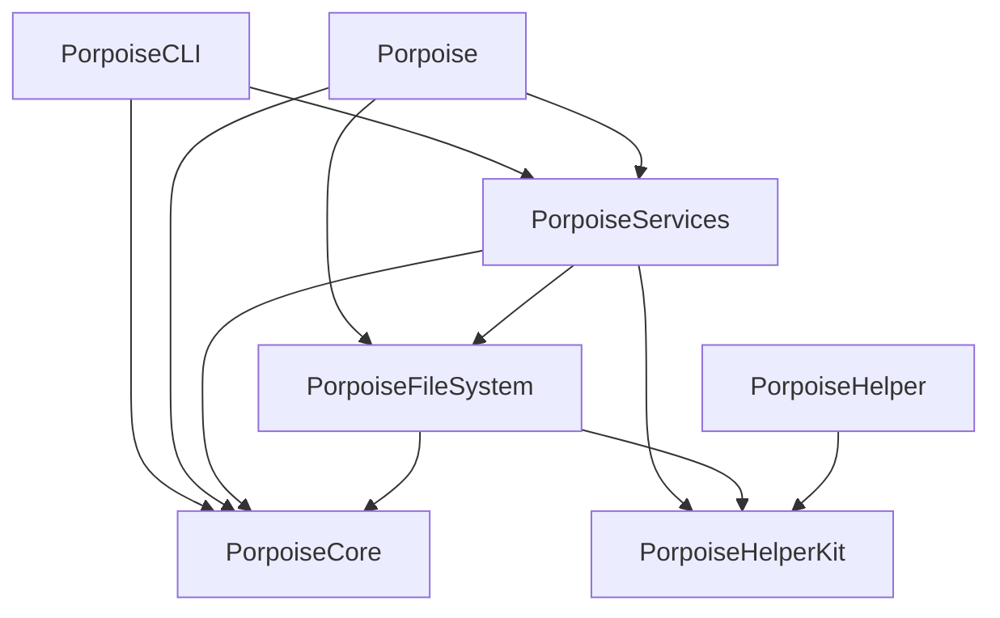

# Architecture

Porpoise separates shared contracts, local filesystem IO, helper security and services into four logic targets, with app orchestration in the executable.

Source inventory reviewed 2026-11-02 against 0.18.0 (`efd41202`); [Package.swift](../Package.swift) is the dependency authority.

## Layers

**PorpoiseCore** (`Sources/PorpoiseCore`). Shared value models, parsers, formatting, index/query algorithms,
conflict policy and synchronization contracts. It performs no filesystem IO, process execution or code-signing
checks. `FileItem` is a value; `FilePath` stores a resolved identity and provides lexical containment. Both
Core and HelperKit are leaves with no project-target dependencies.

**PorpoiseFileSystem** (`Sources/PorpoiseFileSystem`). Local metadata/listing, path resolution, physical traversal,
`FileJob` (copy/move/trash/delete with conflicts), Undo, verification, FSEvents and filesystem containment checks.
It depends on Core and uses HelperKit's strict existing-path resolver. It has no Services, AppKit or SwiftUI dependency.

**PorpoiseHelperKit** (`Sources/PorpoiseHelperKit`). The helper's XPC protocol, caller/request validation, code-signing
checks and strict libc `realpath` primitive. The privileged executable links only this target. Its Objective-C
protocol name is preserved across the module move for installed helper compatibility.

**PorpoiseServices** (`Sources/PorpoiseServices`). The app's behaviour without its looks. It may use Foundation,
AVFoundation, Network, NetFS, Security, ServiceManagement, CryptoKit, UniformTypeIdentifiers, AudioToolbox and SQLite3,
never AppKit or SwiftUI.

| Folder | What |
|---|---|
| `Settings` | `Settings` and `@Pref` (UserDefaults; `Settings.store` is replaceable), settings enums, `PanelSize`, migration |
| `FileOperations` | `FileOperationsController`: jobs, undo/redo, Trash origins and Put Back, clipboard bookkeeping, remote transfers, the administrator retry; `FileOperationsUI` and `FileClipboard` |
| `Locations` | `DirectoryModel` (what a view shows), `PlacesModel`, recent locations, search (bundled fd/ripgrep in folders, Spotlight everywhere) and queries, tags, comments, cloud state, archives, the app library, Trash info, icon names (`IconTheme`), path completion |
| `Remote` | `RemoteFS` and the SSH/FTP/ADB providers, Keychain, Android tools, network mounts and browsing, `RemoteOpener` |
| `Cloud` | Shared account lifecycle, OAuth, metadata/range caches, offline copies, previews, edits and transfer contracts; `CompositeCloudBackend` routes Drive, Dropbox, OneDrive and Box adapters. `DemoCloudBackend` supplies isolated fixtures. |
| `Drive`, `Dropbox`, `OneDrive`, `Box` | Provider OAuth/account stores, HTTP clients, content sources and mutations. `DriveProvider` is a blocking compatibility adapter; new Drive listing uses client pages. |
| `Index`, `Git`, `Diagnostics` | Incremental search indexing; read-only Git status/diff; bounded local events and projected MetricKit crash/hang summaries. |
| `Media` | `VideoPreview` (ffmpeg to HLS) and its local HTTP server |
| `System` | `Shell`, `PrivilegedHelper` (install, XPC, ownership), `PrivacyAccess` (TCC), Local Network access, `StatusCenter`, Finder sounds |

**Porpoise** (`Sources/Porpoise`). AppKit only where it draws or asks: `App` (delegate, `ServicesSetup`, system
integration, updates, test bridge), `Window`, `Views`, `Panels`, `Bars`, `Navigator`, `Menus`, `Dialogs`, `Theme`,
and `FileOperations` (compact Transfers, conflicts, transfer errors and `FileOperationsDialogs`).

**PorpoiseCLI** (`Sources/PorpoiseCLI`). The bundled `porpoise` command parses typed requests in Core and uses the local Unix transport in Services. It never performs file jobs itself; the app owns approval and Transfers.

**PorpoiseHelper** (`Sources/PorpoiseHelper`). The launchd daemon, run as root. It only accepts Porpoise's signature
and hands every request to `HelperRequests` in PorpoiseHelperKit. Its binary is committed in `Resources/Helper`; see
CONTRIBUTING.md before changing anything it uses.

## Rules

- Dependencies point down only as shown above. The helper depends on HelperKit alone.
- No AppKit or SwiftUI in any logic target. When a service needs the user (a question, a login, opening a file), it goes through
  a small hook the app fills in `App/ServicesSetup.swift`: `FileOperationsController.ui` and `.clipboard`,
  `RemoteFS.askLogin`, `RemoteOpener.openFile`. Volume notifications are forwarded to `PlacesModel.refreshDevices()`.
- Services post `Notification`s (`Settings.changed`, `FileOperationsController.foldersChanged`, `PlacesModel.changed`,
  `StatusCenter.message`…); views observe them. Services never hold views.
- `public` only for what the app uses. Settings keys, file formats (places.json, trash origins), bundle and helper
  identifiers and DebugBridge commands are part of users' data and the tests: don't change them.
- Core, FileSystem, HelperKit and Services are where tests go: anything that can be decided without a window belongs there.
- `Settings.isTesting` (set from `PORPOISE_DEFAULTS_SUITE`) keeps test runs away from the system: no helper, no sounds,
  no places.json, a private pasteboard.

## A file operation, end to end

File → Move to Trash (⌘⌫):

1. **Menu → action.** The responder-chain action in `Window/MainWindowActions.swift`
   passes the captured selection and window to `FileOperationsController`.
2. **Routing and questions.** `FileOperationsController+Trash.swift` separates local,
   remote and cloud behavior and any application-cleanup review. `FileOperationsUI` is the
   boundary for questions; the app implements it in `FileOperationsDialogs`.
3. **Execution and progress.** Local work runs through FileSystem's `FileJob` on a worker
   queue. `JobControl` owns pause/cancel/policy checkpoints. Job events update `Activity`
   records; app callbacks and `activityChanged` drive compact Transfers. The internal
   `Activity` type name does not imply a separate Activity/history window.
4. **Results.** Completion publishes folder changes, records the appropriate Undo and
   Trash-origin state, and presents errors through the supplied UI hooks. Recovery and
   operation records are engine state, distinct from the progress window's contents.
5. **Permission denial.** `FileOperationsController+Authorization.swift` retries permitted
   user-owned unlocks or builds a restricted administrator plan. Automated copy/move
   requests disable elevation, including retry/recovery. Tests must not install the helper
   or exercise a real administrator prompt.
6. **Helper.** The installed XPC helper verifies the caller's signature/admin identity and
   `HelperRequests.perform` validates the request, classifies its paths and asks the person
   for the required standard/protected right. Descriptor-based operations act on checked
   objects; the legacy tool/argument arrays are operation identifiers, not executed shell
   commands. See [HELPER-SECURITY.md](HELPER-SECURITY.md) for the separate fallback and recovery limits.
